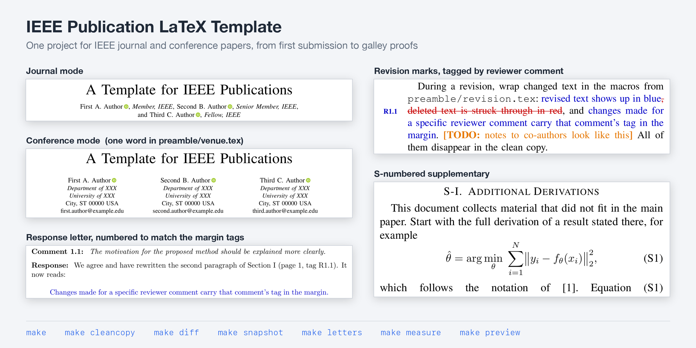

# IEEE Publication LaTeX Template

A LaTeX project for IEEE journal and conference papers built on `IEEEtran`, with the parts that usually get improvised at the last minute already in place: S-numbered supplementary material that the paper references by label, one shared author file, a marked/clean revision switch, latexdiff, a page-budget check, and the letters you need at submission, revision, and proof stage.



**Preview:** [journal paper](preview/main.pdf) · [conference paper](preview/main-conference.pdf) · [supplementary](preview/supplementary.pdf) · [response to reviewers](preview/response.pdf) · [cover letter](preview/cover_letter.pdf) · [proof response](preview/proof_response.pdf)

Built from the one-prompt setup described in [One Prompt, One Complete IEEE Transactions Project With Claude Code](https://blog.wangxm.com/2026/07/ieee-transactions-project-claude-code-one-prompt/), extended with a journal/conference switch.

## Quick start

```sh
make              # main.pdf, supplementary.pdf, response.pdf
make preview      # refresh the PDFs in preview/
```

Then edit `preamble/authors.tex` (title, authors, venue) and the files in `sections/`. On Overleaf, upload the project and compile `main.tex`; see [Overleaf](#overleaf).

## Journal or conference

The venue type is one word in `preamble/venue.tex`:

```latex
\providecommand{\PaperMode}{journal}   % journal | conference
```

`main.tex` and `supplementary.tex` both read it (`\documentclass[\PaperMode]{IEEEtran}`), so one edit switches the whole project. What changes:

| | `journal` (default) | `conference` |
| --- | --- | --- |
| Author block | one line with IEEE memberships, plus footnotes for dates, funding, and affiliations | side-by-side name/affiliation blocks, no footnotes |
| Funding | footnote on page 1 | write it in the Acknowledgment |
| Code/data link (`\PaperDataURL`) | last footnote on page 1 | not printed; put it in the text |
| Running header, page numbers, drop cap | yes | none (IEEEtran drops them) |
| Biographies | at the end of the paper | none |
| Copyright notice | added by IEEE | optional `\IEEEpubid` line, commented in `main.tex` |

The letters don't change with the mode. `response.tex` works as a journal response or a conference rebuttal. `cover_letter.tex` and `proof_response.tex` are journal-stage documents.

## Project map

```
.
├── main.tex                  # paper entry point: preamble, then \input of each section
├── supplementary.tex         # supplementary entry point: S-numbered (S-I, Fig. S1, Eq. (S1), Table S-I)
├── latexmkrc                 # builds the supplement before main.tex when its .aux is missing (also on Overleaf)
├── preamble/
│   ├── venue.tex             # journal | conference switch (loaded before \documentclass)
│   ├── authors.tex           # title, venue name, data URL, per-author details, author block, header
│   ├── revision.tex          # \rev \del \todo \resp and the marked/clean switch
│   └── xref.tex              # \ref{supp:...} from the paper into the supplement (xr-hyper)
├── sections/                 # main paper body, one file per section
│   ├── 01_introduction.tex
│   ├── 02_related_work.tex
│   ├── 03_method.tex
│   ├── 04_experiments.tex    # setup + results, inputs tables/tab_example.tex
│   ├── 05_discussion.tex
│   ├── 06_conclusion.tex
│   ├── biographies.tex       # journal only
│   └── biographies_measure.tex  # full-length stand-in bios for `make measure`
├── supplementary/            # supplementary body: S1_derivations, S2_experiments, tab_ablation
├── tables/                   # main-paper tables, one file per table, caption above
├── figures/                  # figures for both documents; headshots in figures/authors/
├── bib/refs.bib              # one bibliography for both documents
├── letters/
│   ├── response.tex          # point-by-point response to reviewers
│   ├── cover_letter.tex      # submission cover letter (journal)
│   └── proof_response.tex    # galley-proof author-query reply (journal)
├── preview/                  # committed preview PDFs (make preview) and the README image
└── Makefile
```

## Make targets

All commands run from the project root, and every PDF lands in the root.

| Command | Output |
| --- | --- |
| `make` | `main.pdf`, `supplementary.pdf`, `response.pdf` |
| `make main` / `make supp` / `make response` | one of the above |
| `make cleancopy` | `main-clean.pdf` and `supplementary-clean.pdf`, with every revision mark stripped |
| `make letters` | `cover_letter.pdf`, `proof_response.pdf` |
| `make measure` | `main-measure.pdf`: clean copy with full-length photo biographies, and its page count (see [Page budget](#page-budget)) |
| `make preview` | refreshes `preview/`: journal and conference paper, supplementary, all three letters |
| `make snapshot [ROUND=r1]` | `submitted/` (or `submitted_r1/`) plus a zip ready to upload, including the `.bbl` files and `supplementary.aux` |
| `make diff [OLD=submitted_r1]` | `diff.pdf` and `diff-supp.pdf`, latexdiff of the snapshot against the current sources |
| `make clean` / `make distclean` | remove build files / also remove the root PDFs |

Every main-paper target builds the supplement first, because the paper reads its `\ref{supp:...}` numbers from `supplementary.aux`. `distclean` never touches `submitted*/` or `preview/`. `make snapshot` refuses to overwrite an existing snapshot.

Requirements: a TeX distribution with `pdflatex`, `latexmk`, `bibtex`, and the `IEEEtran`, `orcidlink`, `ulem`, `marginnote`, and `hyperref` (for `xr-hyper`) packages (all in TeX Live; on TinyTeX, `tlmgr install` anything missing). `latexdiff` for `make diff`, and `make` and `zip` for the Makefile.

## Revision workflow

1. The day you submit, run `make snapshot`. It copies the sources plus the compiled `.bbl` files and `supplementary.aux` into `submitted/` and zips them. Both matter: submission systems compile your source but don't run BibTeX, and `main.tex` reads its supplementary numbers from that `.aux`.
2. When the reviews come back, edit freely. Wrap changes in `\rev{...}` (blue), `\del{...}` (red strikeout), or `\resp{R1.2}{...}`, which also puts the comment tag R1.2 in the margin. Leave notes for co-authors with `\todo{...}`.
3. `make main` gives the marked-up manuscript, `make diff` the latexdiff PDFs, and `make response` the response letter, where `\reviewer{1}` and the `rcomment`/`answer` environments number comments 1.1, 1.2, and so on to match the margin tags.
4. Before resubmitting, `make snapshot ROUND=r1` freezes that round too.
5. Once accepted, `make cleancopy` builds the camera-ready paper and supplementary with all marks removed, without editing any source file.

The switch itself is a line at the top of `main.tex` and `supplementary.tex`:

```latex
\ifdefined\CleanCopy\else\def\CleanCopy{0}\fi   % 0 = marked, 1 = clean
```

A value given on the command line wins (`make cleancopy`, or `latexmk -pdf -usepretex="\def\CleanCopy{1}" main.tex`), so you only edit the line on Overleaf, or in a paper that should build clean by default. A marked build of such a paper is `-usepretex="\def\CleanCopy{0}"`.

## Referring to the supplement

Never type "Table S-III" by hand. Label things in `supplementary/` as usual (`\label{tab:ablation}`) and refer to them from the paper with the `supp:` prefix:

```latex
see Table~\ref{supp:tab:ablation} and Eq.~\eqref{supp:eq:estimator}
```

`preamble/xref.tex` loads `xr-hyper`, which reads the numbers from `supplementary.aux`. That file has to exist when `main.tex` compiles. `make` builds the supplement first, `latexmkrc` does the same for plain `latexmk` and Overleaf when the `.aux` is missing or `supplementary.tex` changed, and `make snapshot` puts the `.aux` in the submission bundle. One gap: plain `latexmk` doesn't notice edits made only inside `supplementary/`, so after changing those, run `make` or compile `supplementary.tex` once before `main.tex`.

The supplement has its own bibliography. If it cites nothing, or your venue wants all references in the main paper, delete the two bibliography lines at the end of `supplementary.tex` (an empty bibliography is a compile error) and cite in plain text there. For a long supplement, uncomment `{\small\tableofcontents}` after `\maketitle`; the table of contents is already widened for numbers like S-VIII.

## Page budget

Many IEEE venues charge for pages beyond a limit that includes references and biographies, and the short placeholder bios in `sections/biographies.tex` take far less room than real ones. `make measure` builds `main-measure.pdf` from the clean copy with `sections/biographies_measure.tex` (three ~110-word bios with photo boxes) and prints its page count; `main.pdf` is untouched. Match the number of stand-in bios to your author list. A biography with a photo doesn't break across columns, so the count moves in steps: trimming a few lines may change nothing until a whole biography fits in the column above.

## Overleaf

`main.tex` and `supplementary.tex` stay at the root on purpose: submission systems compile an entry file from its own folder, and every path here is written from the root. All paths are relative to the project root, so the project can be uploaded to Overleaf as is. `main.tex` is picked as the main document. To build the supplementary or a letter, change the main document in the Overleaf menu. Overleaf runs `latexmk`, and the project's `latexmkrc` follows Overleaf's documented setup for `xr` so the supplement compiles first and `\ref{supp:...}` resolves (tested with local `latexmk`, not yet on Overleaf itself; if the references show "??" there, compile `supplementary.tex` once, then `main.tex`). If you edited files in `supplementary/`, compile `supplementary.tex` once before `main.tex`.

Make targets don't run on Overleaf. For the clean copy there, change `\def\CleanCopy{0}` to `1` in the line at the top of `main.tex` (and `supplementary.tex`). Snapshots, latexdiff, and `make measure` are local-only.

## For AI agents

This section is for coding agents (Claude Code, Codex, Cursor, and so on) working in this repo. People editing by hand can follow it too.

### Rules

1. **Author and venue facts live only in `preamble/authors.tex`.** Never type a title, author name, affiliation, email, ORCID, venue name, or manuscript ID into `main.tex`, `supplementary.tex`, a section, or a letter. Use the macros (`\PaperTitle`, `\PaperVenue`, `\PaperManuscriptID`, `\PaperAuthorsPlain`, `\AuthorA`, `\AuthorAEmail`, ...).
2. **Every path is relative to the project root.** Write `\input{sections/03_method}` and `\input{preamble/authors}`, never `../`. Letters are compiled from the root (`latexmk -pdf letters/response.tex`), not from `letters/`.
3. **Entry files stay at the root.** Don't move `main.tex` or `supplementary.tex` into a folder.
4. **One file per section and per table.** Main-paper sections go in `sections/`, supplementary sections and tables in `supplementary/`, main-paper tables in `tables/`.
5. **No top-level `\ifCLASSOPTION...` in `preamble/authors.tex`.** The letters use the `article` class, where those conditionals don't exist; mode-dependent code goes inside a macro body.
6. **Keep it Overleaf-safe.** No `-shell-escape`, no `-outdir`, no packages outside TeX Live, no build step that only works through `make`.
7. **Don't delete or overwrite `submitted*/`.** Those snapshots are the baseline for `make diff`.
8. **Write one paragraph per line** in `.tex` files (no hard wrapping), including multi-line `%` comments.
9. **Only `preview/*.pdf` is tracked.** Root PDFs and build files are git-ignored; don't commit them.
10. **Never hard-code a supplementary number in the paper.** Write `\ref{supp:<label>}`; labels inside `supplementary/` have no prefix. Don't write "Table S-II" or "Section S-I" by hand.

### Common tasks

- **Change title, venue, or an author's details:** edit the matching macro in `preamble/authors.tex`. Every PDF picks it up.
- **Set or remove the code/data link:** `\PaperDataURL` in `preamble/authors.tex`. Journal mode prints it as the last first-page footnote; `\newcommand{\PaperDataURL}{}` drops the footnote. The URL must not contain `%` or `#`.
- **Add a fourth author:** in `preamble/authors.tex`, copy the `\AuthorC...` block as `\AuthorD...`, add the author to both branches of `\PaperAuthors` (conference: another `\and` + `\IEEEauthorblockN`/`\IEEEauthorblockA`; journal: the author line and a `\thanks`), and update `\PaperAuthorsPlain`. Add a biography in `sections/biographies.tex`.
- **Switch to conference:** change `journal` to `conference` in `preamble/venue.tex`. Move the funding sentence into the Acknowledgment in `main.tex`.
- **Add a section:** create `sections/0N_name.tex` starting with `\section{...}` and `\label{sec:name}`, then add `\input{sections/0N_name}` in `main.tex` in reading order. Renumber files if you insert one in the middle.
- **Add a table:** create `tables/tab_name.tex` with a `table` environment, caption above, `\label{tab:name}`, and `\input` it from the section that first refers to it.
- **Add a figure:** put the PDF/PNG in `figures/` and use `\includegraphics{name}` (no folder prefix needed). Caption below, `\label{fig:name}`.
- **Add a reference:** add the BibTeX entry to `bib/refs.bib` and `\cite{key}` it.
- **Add supplementary content:** create `supplementary/S3_name.tex` with `\section{...}` and `\label{sec:name}`, and `\input{supplementary/S3_name}` in `supplementary.tex`. Refer to it from the paper as `Section~\ref{supp:sec:name}`.
- **Check the page count against the venue limit:** `make measure` (journal mode).
- **Mark a revision for reviewer comment k of reviewer N:** wrap the new text in `\resp{RN.k}{...}` and answer it in `letters/response.tex` under `\reviewer{N}` (the k-th `rcomment`).

### Verify a change

1. Build: `make` (plus `make letters` if you touched `preamble/authors.tex` or `letters/`, and `make cleancopy` if you touched `preamble/revision.tex`). A non-zero exit is a failure.
2. Check the logs: `grep -n "^!" *.log` must print nothing, and `grep "Warning" main.log` should not report undefined references or citations, or `xr` failing to find `supplementary.aux`.
3. Look at the output, not just the exit code. Render pages (`pdftoppm -r 80 -png main.pdf /tmp/page`) or open the PDF and check the change is there and nothing else moved.
4. If you changed anything that affects both venues, also build the conference version: `latexmk -pdf -jobname=main-conference -usepretex='\def\PaperMode{conference}' main.tex`.
5. If the template itself changed, run `make preview` so the committed previews match.

## Checklist before submitting

- Replace every `XXX`, the placeholder ORCID iDs, and the example `.bib` entries. Set `\PaperDataURL` or empty it.
- Delete the revision-markup demo paragraph in `sections/01_introduction.tex`.
- Check that the last page's columns are balanced. If they aren't, add `\usepackage{flushend}` or `\IEEEtriggeratref{n}` before the bibliography.
- Run `make measure` with your real number of authors and check the page count against the venue's limit.
- Run `pdfinfo main.pdf` to make sure the PDF title, author, and keywords are right.
- Upload `supplementary.aux` with the source (the `make snapshot` zip has it), or the paper's supplementary references print as "??".

## License

[MIT](LICENSE), covering the template files. `IEEEtran.cls` is not included here; it comes with your TeX distribution under its own license (LPPL).
